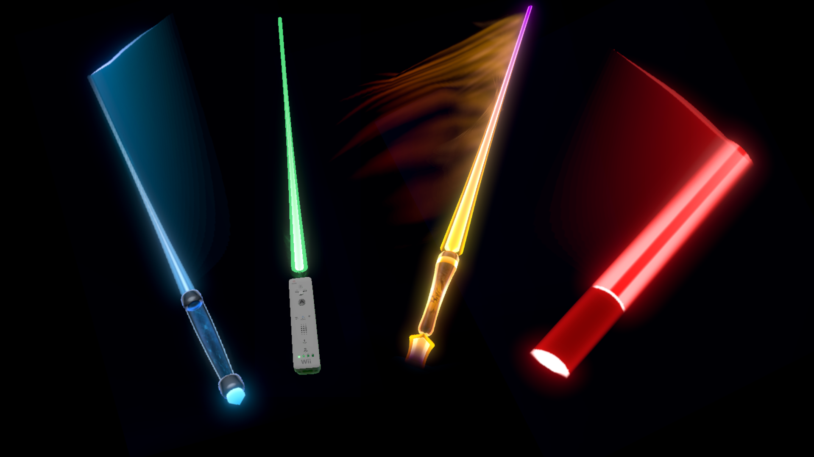

VainSabers is a blursaber mod for beat saber, like ReeSabers but worse.



This is somewhat buggy in its current state. It works well once you get it going and all configured.

`VainSabers` is the source project, which has the main mod code. `VainSabers asset creation` is the unity project used to create the asset bundle used, and also has some code adapted from the mod to help visualize stuff.

If you would like to see features added, please drop a suggestion in the discord server.
If you personally want to help, feel free to make pull requests.

### Motion blur tests

Run `BladeMotionBlurTests` in the Unity Test Runner's Edit Mode tab with graphics enabled. On Windows, the same Direct3D 11 checks can run in batch mode.

```powershell
& '<path to Unity.exe>' -batchmode -force-d3d11 -projectPath '<path to VainSabers asset creation>' -runTests -testPlatform EditMode -testFilter BladeMotionBlurTests -testResults '<path to test-results.xml>'
```

### AI was used to help with developing this mod.
Further: Major architecture and systems were designed by a human (me) and implementation was AI-assisted, human-reviewed, tested, and tweaked if necessary.
If this bothers you, you are free to not use this mod.
